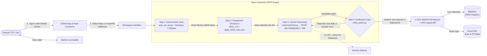

# Sentinel-DPDP — System Architecture & Startup User Workflow

> **Status:** Phase 1 Complete (Skill + Deterministic Scanner + Verification Gate + Demo Target + Stitch UI Blueprint)  
> **Target Users:** Indian Startups, FinTechs, SaaS teams, Dev Agencies (CTOs, Engineering Leads, DPOs)

---

## 1. End-to-End Startup User Journey (GitHub Login → Auto-Fix PR)



---

## 2. How the Current Files & Folders Map to the Full System

```text
d:\Sentinel-DPDP\
├── .agent/skills/dpdp-compliance-auditor/   # [DONE] Google Agent Skills (Progressive Disclosure)
│   ├── SKILL.md                             #   Level 1 YAML + Level 2 4-step workflow
│   ├── references/dpdp_2026_rules.json      #   Level 3 India DPDP Act 2023 + Rules 2025 pack
│   └── scripts/
│       ├── scan_pii_ast.py                  #   Level 3 Deterministic Python AST + JS/TS + SQL + Verhoeff Aadhaar
│       └── verify_patch.py                  #   Level 3 Verification gate (rescan + no new leaks + compile check)
├── demo_vulnerable_app/                     # [DONE] "PaisaFlow" live test target (4 planted violations)
│   ├── backend/main.py                      #   Violations 1 & 2: raw Aadhaar/PAN log + unredacted phone to OpenAI
│   ├── backend/db/schema.sql                #   Violation 3: customers table missing retention_purge_at
│   └── frontend/components/SignupConsent.tsx#   Violation 4: pre-checked marketing consent (dark pattern)
├── design/                                  # [DONE] Google Stitch UI export
│   ├── dashboard.html                       #   Exported Stitch HTML (45 KB)
│   ├── dashboard.png                        #   10/10 Dark-mode DevSecOps Control Plane screenshot
│   └── architecture_workflow.html           #   Interactive downloadable architecture & workflow diagram
├── docs/
│   └── ARCHITECTURE_WORKFLOW.md             #   This file (Mermaid + folder/UI analysis)
└── DESIGN.md                                # [DONE] Full token spec, 10 components, WCAG AA & API mapping
```

---

## 3. UI Analysis: How a Startup Uses the Control Plane

| UI Zone (from `design/dashboard.png`) | Startup User Action | Backend Endpoint (Phase 2) |
|---|---|---|
| **Top Bar** (`github.com/acme/fintech-api`, Env tabs, `Run Scan`) | Connect GitHub repo via OAuth, pick branch/env, trigger scan | `POST /api/scan` |
| **Left Sidebar + Risk Gauge** (`82/100 Critical`, Severity Queue, DPDP Sec 5/6/8(5)/8(7) chips) | See instant DPDP exposure score & which legal sections fail | `GET /api/findings` |
| **Center Table + Side-by-Side Diff + Citation Card** | Click any `file:line` leak, inspect vulnerable vs. fixed code, read exact DPDP Act fine (up to ₹250 Cr) | `GET /api/findings/{id}` |
| **Right Top: Auto-Fix Pull Request Panel** | Review 4 green verification checks → click **Open Pull Request** | `POST /api/fix-pr` |
| **Right Bottom: Ask the Auditor** (`Gemini Live`) | Ask by voice/text: *"Why is this flagged under Sec 8(5)?"* | `POST /api/ask` |
| **Footer** (`Gemma Redaction · BigQuery Telemetry`) | View in-VPC redaction & cross-repo BigQuery compliance analytics | `POST /api/redact` |
